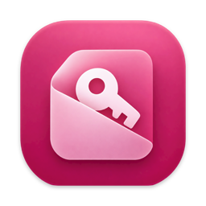
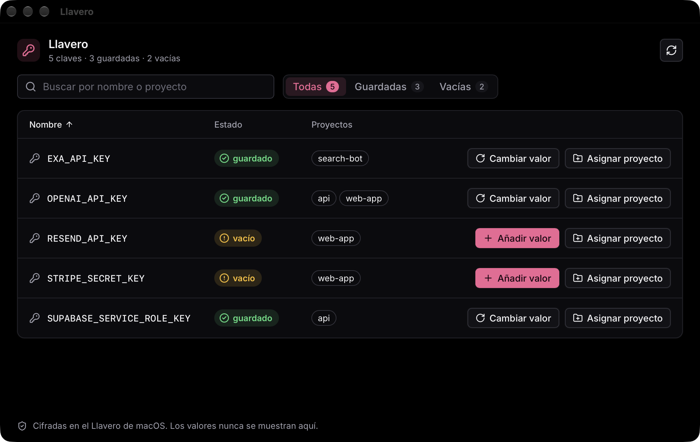
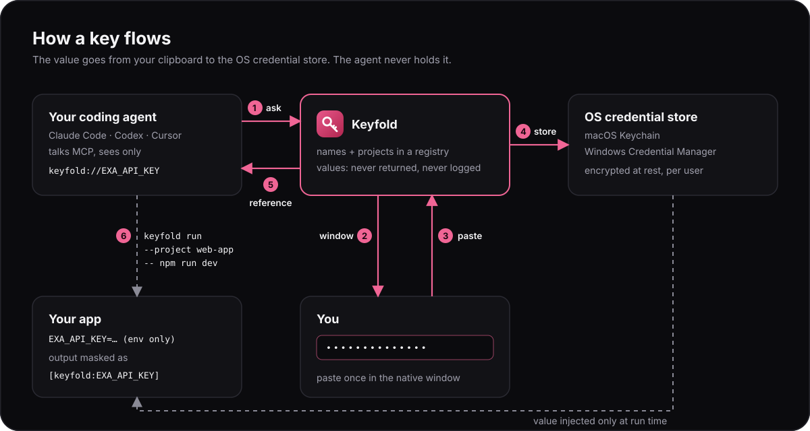
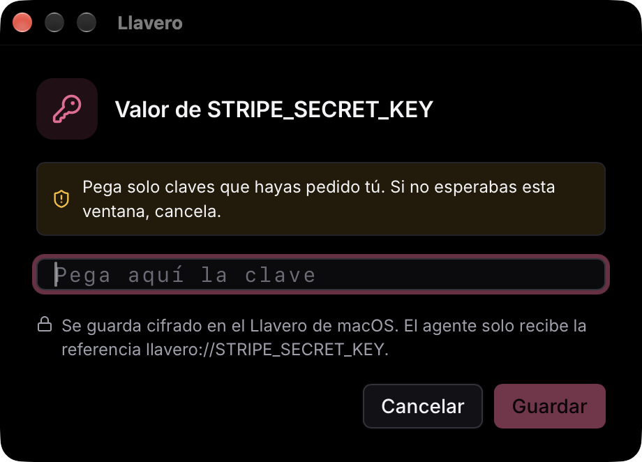
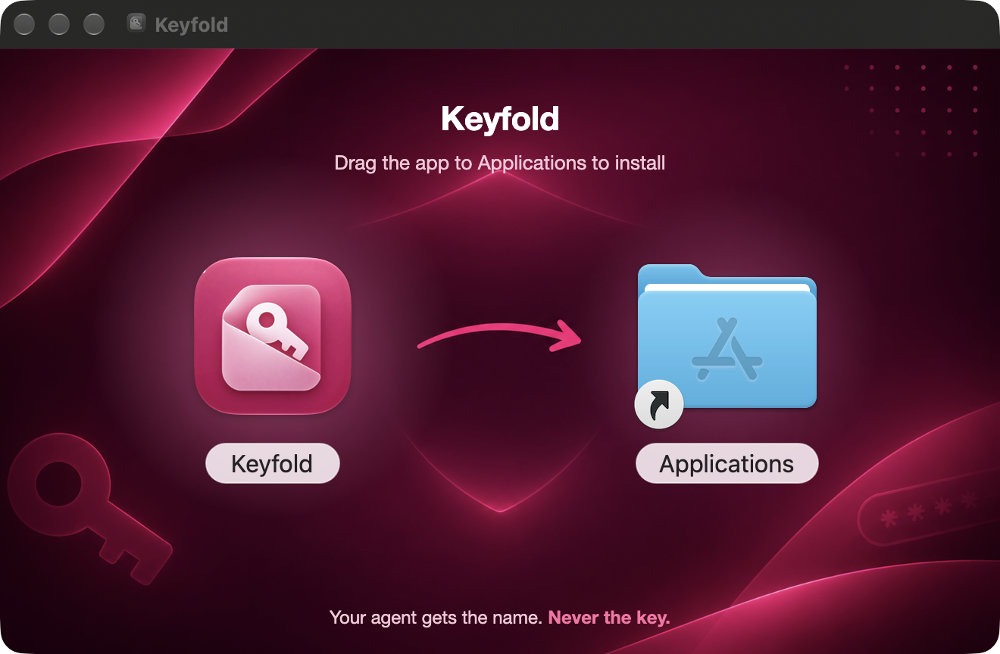

<div align="center">



# Keyfold

**A key wallet for your coding agent: it can use your API keys, but never see them.**

Paste each key once. Keyfold keeps it in your OS credential store, gives your agent a reference,<br>
and injects the value only when your app runs.

<a href="https://github.com/diegoperezg7/keyfold/releases/latest"><b>Download for macOS</b></a> ·
[How it works](#how-it-works) · [Connect your agent](#connect-your-agent) · [Commands](#commands) · [Security](#security)


</div>

<br>

<p align="center">
  
</p>

## Why it exists

I use Keyfold every day with my own coding agents: they run my projects with the keys, without reading one.
It is open source in case it helps you too.

## The problem

Giving your agent a key means pasting it into the chat or a `.env` it can read. Either way it ends up
in a transcript, a log or a commit. Keyfold splits the job in two:

| | Who handles it | Where it lives |
|---|---|---|
| **The value** | Only you, once, in a native window | macOS Keychain / Windows Credential Manager |
| **The name** (`EXA_API_KEY`) | You and your agent | A small registry of names and projects |

Your agent creates the slot, wires it up and runs the app. It never receives the value.

## How it works

<p align="center">
  
</p>

A typical session:

> **You:** I've got the Exa key for the search feature.
>
> **Agent:** calls `create_secret("EXA_API_KEY", project: "search-bot")`
>
> **Keyfold:** opens this window. You paste, press Enter, done.

<p align="center">
  
</p>

> **Agent:** gets `keyfold://EXA_API_KEY`, then starts your app with
> `keyfold run --project search-bot -- npm run dev`.
> Your app reads `process.env.EXA_API_KEY` as usual. If anything prints the key, the output shows `[keyfold:EXA_API_KEY]`.

### Working with a team

No cloud, no accounts. Each person keeps their keys on their own machine. The project refers to a key
only by name, so the same code works for everyone and each Keyfold injects its own copy.

### Sharing keys, and your keys on another Mac

`keyfold share NAME --to age1…` (or **Share › Send**) encrypts keys to someone's public key (`keyfold id`)
as an [age](https://age-encryption.org) package; only they can open it, with `keyfold import` or
**Share › Receive**. Sharing asks for Touch ID, so an agent cannot send keys to itself.
For another Mac of yours, use that Mac's public key with `--all` and move the package with AirDrop.

### In the app

- **New key** creates a key by hand, no agent needed.
- **Show** reveals a value to you after Touch ID (macOS; Windows does not ask yet, see [SECURITY.md](SECURITY.md)).
  It hides after 30 seconds and is kept out of screenshots. No CLI command or MCP tool can do this.

## Install

**macOS (Apple Silicon):** download the DMG from the [latest release](https://github.com/diegoperezg7/keyfold/releases/latest)
(signed and notarized) and drag Keyfold to Applications.

<p align="center">
  
</p>

**Other platforms, or from source.** You need:

- [Rust](https://rustup.rs) (stable) and Node.js 22+
- macOS: the Xcode Command Line Tools (`xcode-select --install`)
- Windows: the Microsoft C++ Build Tools and WebView2 (preinstalled on Windows 11)

```sh
git clone https://github.com/diegoperezg7/keyfold.git
cd keyfold/desktop
npm ci
npx tauri build --bundles app       # macOS: target/release/bundle/macos/Keyfold.app
# npx tauri build --bundles nsis    # Windows: target/release/bundle/nsis/Keyfold_*-setup.exe
```

On macOS, copy it with `ditto target/release/bundle/macos/Keyfold.app /Applications/Keyfold.app`.

The same binary is the app, the CLI and the MCP server. Link it into your `PATH` (an `alias` is not
enough: your agent's shell ignores it):

```sh
sudo ln -sf /Applications/Keyfold.app/Contents/MacOS/keyfold /usr/local/bin/keyfold
keyfold list
```

Without it, the MCP server tells your agent the full path. Open the app once (`open -a Keyfold`):
it stays in the menu bar; quit it from there.

### Updates

Installed from a release DMG, Keyfold updates itself: **Update** in the keys window downloads,
verifies, installs and restarts. Builds from source do not; pull and build again.

### Signed DMG (maintainers)

`npm run dmg` (in `desktop/`) builds the app and the DMG, signs both with the Developer ID in your
keychain, signs the update archive and writes `latest.json`. It also notarizes and staples the DMG
with the notarytool profile `keyfold-notary` (`KEYFOLD_NOTARY_PROFILE=` skips it). Credentials stay
in your keychain or home folder, never in the repo.

```sh
xcrun notarytool store-credentials keyfold-notary --apple-id you@example.com --team-id TEAMID   # once
npx tauri signer generate --ci -w ~/.tauri/keyfold-updater.key                                  # once; back it up
KEYFOLD_RELEASE_NOTES=notes.txt npm run dmg
```

Bump `version` in `src-tauri/tauri.conf.json` first, then publish with the `gh release create` command
the script prints. Lose the updater key and installed copies stop updating.

## Connect your agent

Keyfold speaks [MCP](https://modelcontextprotocol.io) over stdio. One command registers it
(or **Connect agent** in the menu bar):

```sh
keyfold connect claude    # runs `claude mcp add --scope user keyfold ...`
keyfold connect codex     # adds [mcp_servers.keyfold] to ~/.codex/config.toml
keyfold connect cursor    # adds "keyfold" to ~/.cursor/mcp.json
```

Restart the agent afterwards. By hand:

**Claude Code**

```sh
claude mcp add --scope user keyfold -- /Applications/Keyfold.app/Contents/MacOS/keyfold mcp
```

**Codex** (`~/.codex/config.toml`)

```toml
[mcp_servers.keyfold]
command = "/Applications/Keyfold.app/Contents/MacOS/keyfold"
args = ["mcp"]
```

**Cursor** (`~/.cursor/mcp.json`, or `.cursor/mcp.json` in one project)

```json
{ "mcpServers": { "keyfold": { "command": "/Applications/Keyfold.app/Contents/MacOS/keyfold", "args": ["mcp"] } } }
```

### MCP tools

None of them returns a value.

| Tool | What it does |
|---|---|
| `list_secrets` | List keys (optionally for one project) |
| `create_secret` | Create a slot, assign it to a project, open the paste window. Waits until you save or cancel |
| `request_secret_value` | Open the paste window to add or replace the value of an existing key |
| `assign_secret` | Make an existing key available to a project |
| `unassign_secret` | Take a key out of a project, e.g. a misspelled one |
| `link_folder` / `unlink_folder` | Link a local folder to a project on this machine, or remove the link |

## Commands

| Command | What it does |
|---|---|
| `keyfold` | Open the app |
| `keyfold create NAME [--project P] [--no-prompt]` | Create a slot and open the paste window |
| `keyfold receive NAME` | Receive mode: create the slot if missing and open the paste window |
| `keyfold set NAME [--stdin]` | Store or replace a value (window, or stdin) |
| `keyfold assign NAME --project P` | Make a key available to a project |
| `keyfold unassign NAME --project P` | Take a key out of a project (the key and its value stay) |
| `keyfold list [--project P]` | Names, status and projects. Never values |
| `keyfold run [--project P] -- <command>` | Run with the project's keys in the environment, output masked. Without `--project`, uses the nearest `.keyfold` or linked folder |
| `keyfold link [FOLDER] --project P` | Link a folder (default: the current one) to a project, on this machine only |
| `keyfold unlink [FOLDER]` / `keyfold folders` | Remove a folder link / list linked folders |
| `keyfold delete NAME` | Delete a key and its value |
| `keyfold id` | This computer's public key (`age1…`), for others to share keys with you |
| `keyfold share NAME... \| --all --to age1… [--out FILE]` | Encrypt keys for those recipients only (asks for Touch ID) |
| `keyfold import [FILE]` | Import a package encrypted for this computer (or from stdin) |
| `keyfold mcp` | MCP server over stdio |
| `keyfold connect claude\|codex\|cursor` | Register Keyfold as the agent's MCP server |

A `.keyfold` file at the repo root with the project name ties the folder to it, so `keyfold run -- npm run dev`
works anywhere inside. It holds only a name, so commit it. `keyfold link --project P` does the same on your
machine only, without a file. The nearest one wins; at the same level, the file.

## Security

Full review in [SECURITY.md](SECURITY.md).

| Keyfold protects against | Keyfold does **not** protect against |
|---|---|
| Keys pasted into chats, transcripts and agent context | A process started by `keyfold run` reading its own environment and sending the key elsewhere |
| Keys in `.env` files, commits and screenshots | Malware running as your user |
| Keys printed to the terminal by your app (masked) | Encoded or partial copies of a key in output (only the exact value is masked) |
| The key lingering in your clipboard after you paste it (macOS) | Clipboard history apps that already recorded it |
| Typing meant for another app being saved by accident (Enter only saves pasted text) | A tricked agent asking you for a key you didn't request (the window warns you; cancel it) |

- **Values:** the OS credential store (macOS Keychain, Windows Credential Manager).
- **Names, projects and linked folders:** `registry.json` in your user data folder. Never values.

## Project layout

```
desktop/                    the app (Tauri 2)
  crates/keyfold-core/      storage, registry, masking: plain Rust, no UI
  src-tauri/                one binary: app + CLI + MCP server
  src/                      UI: React, TypeScript, Zustand
Sources/, Tests/            the original native macOS prototype (Swift)
docs/                       images and the Swift prototype notes
```

## Development

```sh
cd desktop
npm test                    # UI logic and paste-window state
cargo test --workspace      # core + CLI/MCP contract against the real credential store
npx tauri dev               # run the app with hot reload
```

The contract tests drive the real binary like an agent and fail if any output contains a stored value.
